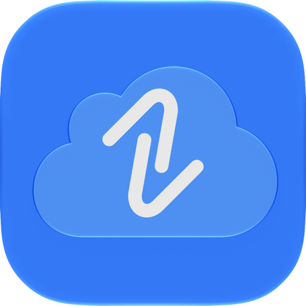

  

# Privacy Policy

Last updated: October 13, 2026

Privacy is central to DistilledLink’s design. The app uses only Apple’s services for file hosting and synchronization. The developer operates no servers for the app and does not collect or host your files. The app contains no advertising, tracking, or analytics code.

## Files and iCloud

The app accesses the iCloud Drive folders you authorize to browse files and create download links through Apple’s services. Original files remain in iCloud Drive. Anyone with a generated link can download its file until it expires; the app cannot revoke links early.

Link history (including file information, download links, thumbnails, and device details) and settings are stored on your devices and synced through your Apple Account’s private iCloud database. This supports history, statistics, and synchronization between your devices. The developer cannot access that database.

Apple handles this data under its [Privacy Policy](https://www.apple.com/legal/privacy/en-ww/) and protects it with encryption during transfer and storage, as described in its [iCloud security overview](https://support.apple.com/102651). Apple requires its service providers to handle personal data consistently with its privacy policy.

## Diagnostics

Diagnostic reports stay on your device and are never automatically sent to the developer. You decide whether to email or share a report for support.

Reports include technical activity, app and OS versions, settings, purchase-access status, file extensions, broad size ranges, link share dates, and temporary troubleshooting references. They exclude filenames, file contents, download links, account details, and persistent device identifiers. Review reports before sharing.

iCloud sync automatically sends a random session reference to Apple’s CloudKit service. This reference changes each time the app launches and contains no name or email address. The developer can view [Apple’s CloudKit service logs](https://developer.apple.com/icloud/logs/), which show technical activity, such as timing and errors, and identifiers specific to your account within this app’s iCloud container. These logs alone do not reveal your name or email address to the developer, or provide access to your files or private iCloud database contents.

If you choose to share a diagnostic report, its session reference lets the developer find the matching CloudKit activity. Sending the report by email includes your sender address, which connects that activity to your support email. Without information you choose to share, the logs and references alone do not tell the developer who you are. Shared reports and related logs are used only for troubleshooting and support.

These account references and the connection to support emails explain why diagnostics may be described as “linked to you” in [the App Store’s privacy information](https://developer.apple.com/app-store/app-privacy-details/#data-linked-to-the-user). The app does not automatically collect your name or email address or use this information for advertising or tracking.

## Retention and control

Link history and settings remain on your devices and in iCloud until removed. Deleting an expired history entry removes its file name, link, and thumbnail, but retains its ID, file size, extension, and share date for statistics, deletion synchronization, and the free-link allowance.

You can change folder access in the app’s settings and disable iCloud access in system settings. Deleting the app removes its local data; iCloud data and backups must be removed separately through your Apple Account’s iCloud settings. Your original files are unaffected.

## Changes to this policy

This policy may be updated as the app evolves. Updates will be posted here with a revised “Last updated” date. Previous versions and changes can be viewed in [this file’s commit history](/../../commits/main/PRIVACY.md). When required, you will be notified and your consent obtained before changes take effect.

## Contact and support

DistilledLink is developed by Dane MacMillan. For privacy questions or to request deletion of support correspondence, email [distilledlink@icloud.com](mailto:distilledlink@icloud.com). Your email address, message, and any diagnostic reports you share are used only to handle your request and kept only as long as needed to resolve it.

Support requests posted in the [public GitHub repository](/../../issues) are publicly visible and subject to [GitHub’s Privacy Statement](https://docs.github.com/en/site-policy/privacy-policies/github-general-privacy-statement).

---

  <a href="https://github.com/danemacmillan/DistilledLink-support">Home</a> ·
  <a href="PRIVACY.md">Privacy Policy</a> ·
  <a href="TERMS.md">Terms of Use</a> ·
  <a href="SUPPORT.md">Support</a>

